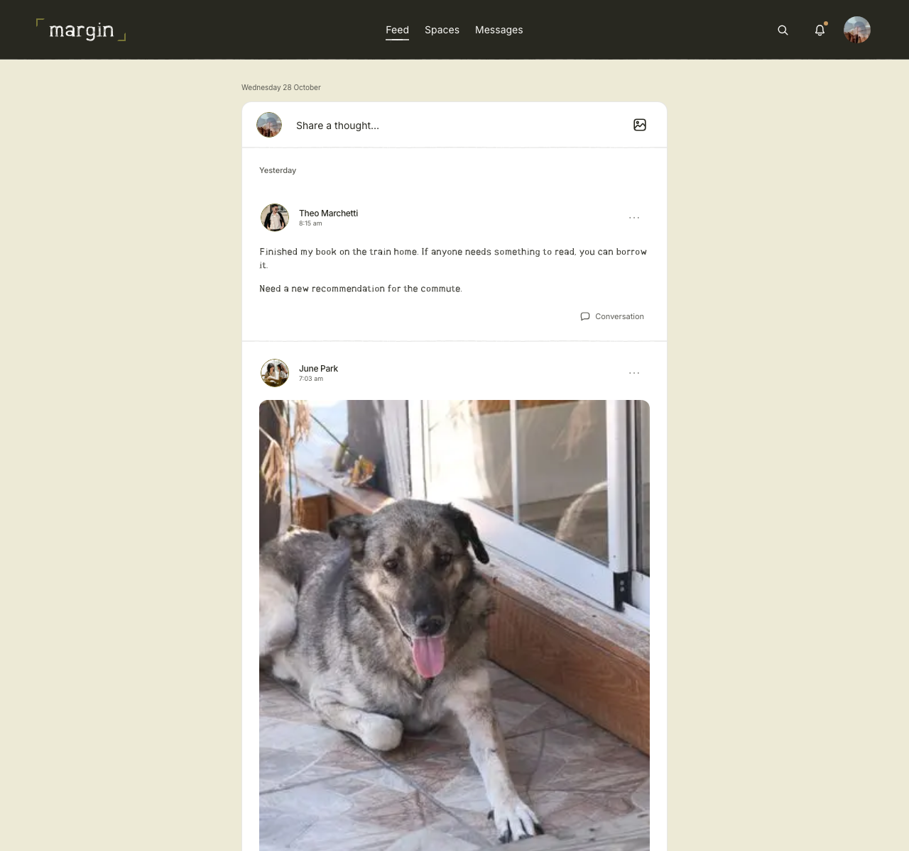
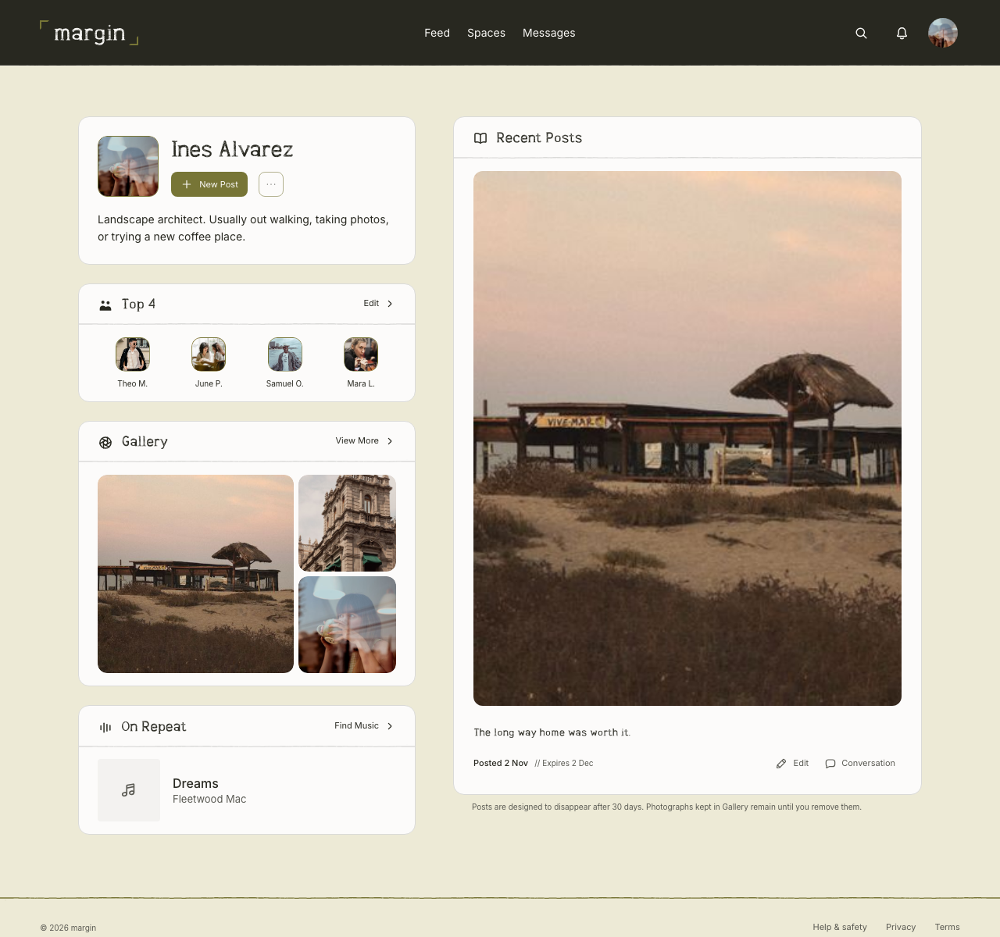
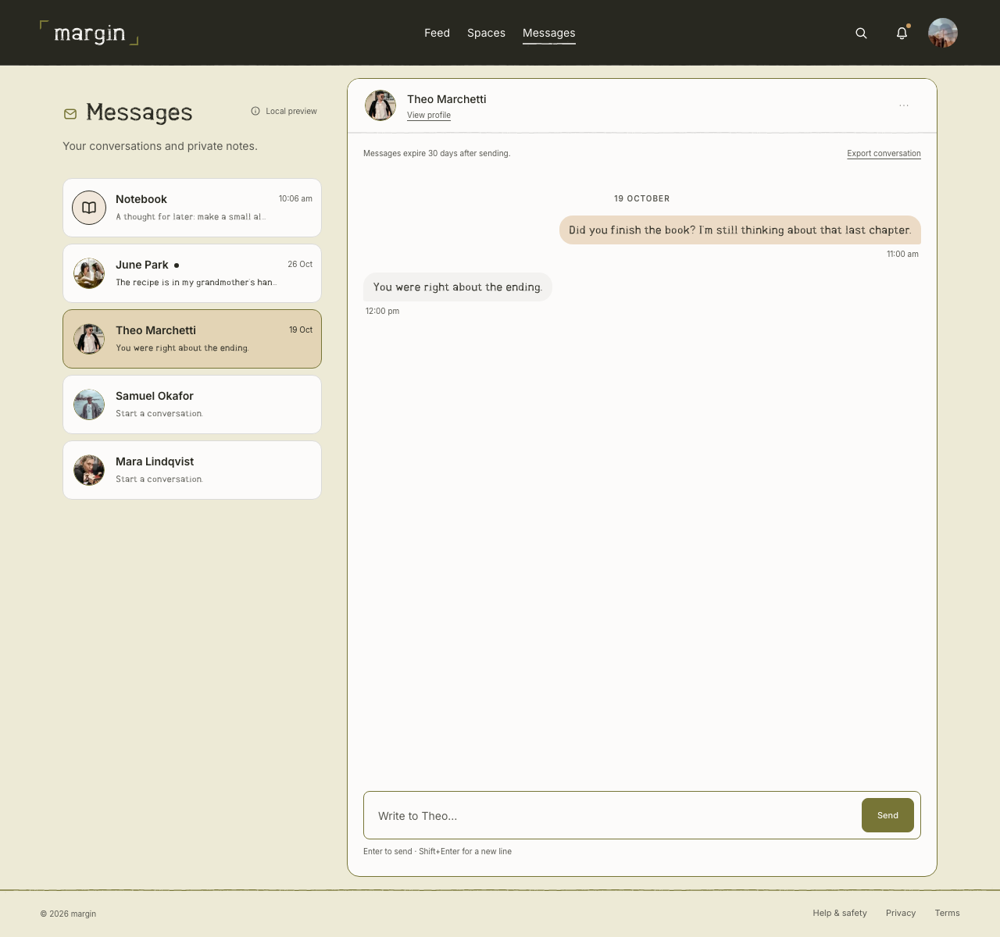

# Margin

A small social space for friends, with a feed that ends and room for everything else. Margin is invitation-only, built around mutual friendship and a chronological feed—without ads, recommended strangers, or like counts in the feed.

[Website](https://margin.social) · [Help](https://margin.social/help) · [Privacy](https://margin.social/privacy) · [Contact](mailto:support@margin.social)

## Preview

Welcome, news feed, profile, and messages. App screenshots use fictional sample data.

|                                    Welcome                                     |                           News feed                            |
| :----------------------------------------------------------------------------: | :------------------------------------------------------------: |
|                               |       |
|                                  **Profile**                                   |                          **Messages**                          |
|  |  |

## Features

- **A finite feed.** Chronological posts from friends and selected Spaces, with a clear end to catching up.
- **A little each day.** Up to three regular posts, or one link-containing post as the day's only post. Posting follows each member's saved time zone.
- **Personal profiles.** A Gallery of up to 20 photographs, three featured photos, Top 4 friends, and an On Repeat song.
- **Messages and Notebook.** Private conversations expire after 30 days; personal Notebook notes expire after 90 days.
- **Spaces.** Invitation-only groups for shared thoughts, photographs, and plans.
- **Member controls.** Reading and motion preferences, messaging settings, reporting, account downloads, and account-erasure requests.

## Privacy and access

Personal posts and Gallery content are shared with accepted friends. Profile introductions are discoverable by signed-in members; Spaces have their own membership boundaries. Member APIs enforce identity, account eligibility, ownership, and audience permissions on the server.

Messages are stored on the server and are **not end-to-end encrypted**. Expiry restricts reads and exports; scheduled maintenance removes expired content and retries private-media cleanup. Reported content can be available for restricted moderation review. Retention and deletion boundaries are documented in [Privacy](https://margin.social/privacy) and [Retention](https://margin.social/retention).

## Technology stack

| Layer          | Technologies                          |
| -------------- | ------------------------------------- |
| Application    | Next.js App Router, React, TypeScript |
| Interface      | Radix UI, CSS design tokens           |
| Persistence    | PostgreSQL, Prisma                    |
| Authentication | Clerk                                 |
| Rate limiting  | Upstash Redis                         |
| Private media  | Cloudflare R2                         |
| Observability  | Sentry                                |
| Testing        | Vitest, Testing Library, Playwright   |

## Development

### Requirements

- Node.js 22.12 or later within the Node 22 release line; see `.nvmrc`.
- npm and PostgreSQL.
- Clerk, Redis, and private photo-storage configuration for authenticated development.

### Setup

Configure local environment variables using [`.env.example`](.env.example), then run:

```sh
nvm use
npm ci
npm run dev
```

The development server runs at [localhost:3000](http://localhost:3000). `/welcome` serves the public website, and `/app` opens the authenticated member application. Development-only previews use fictional data and separate local state. Production `/` serves the public website; development preview routes are unavailable in production.

`npm run db:local` manages the local PostgreSQL cluster. Database migrations are applied separately; dependency installation does not modify the application database. Authentication and invitation setup are covered in [Account flows](docs/account-flows.md).

### Configuration

| Integration   | Configuration                                                                              |
| ------------- | ------------------------------------------------------------------------------------------ |
| Clerk         | Matching instance keys, canonical origin, invitation-only registration, and verified email |
| PostgreSQL    | Runtime `DATABASE_URL`; separate `MIGRATION_DATABASE_URL` for migrations                   |
| Upstash Redis | REST URL and read/write token                                                              |
| Photo storage | Private R2 bucket and scoped credentials; filesystem storage for local development         |
| Ticketmaster  | Server-only Discovery API key for event-search integration                                 |
| Music catalog | Catalog search and authenticated persistence for On Repeat selections                      |
| Sentry        | Optional DSN and trusted build-time source-map upload configuration                        |

Development and production credentials remain separate. Environment files, credentials, local databases, and private working files are excluded from Git. Invitation URLs are credentials and must not appear in committed logs or reports.

### Builds and local review

```sh
npm run build
npm start
```

Development hot-reloads source changes. Production commands serve compiled builds and reject stale output or occupied ports. For an isolated production-style local review with development Clerk credentials:

```sh
npm run review -- --localhost
```

Local review uses `.local/local-review/next` and preserves the standard development output. Generated-artifact cleanup and storage checks are available through:

```sh
npm run local:check
npm run clean:local -- --apply
```

## Verification

```sh
# Formatting, types, lint, stylesheet checks, and unit/component tests
npm run check

# Focused checks
npm run check -- tests/profile-posts-ui.test.tsx

# Full verification required before pushing
npm run verify

# Additional presentation and cross-browser checks
npm run verify:extended
```

Full verification includes disposable PostgreSQL integration tests, a production build, desktop/mobile browser journeys in development and production, and dependency audits. Verification runs in credential-free temporary source snapshots and leaves the development server unchanged.

Install the browser dependency and Git hook with:

```sh
npm run test:e2e:install
npm run hooks:install
```

The pre-push hook requires a clean working tree and full verification of the commit being pushed. GitHub Actions runs the same workflow. Test reports, traces, and failure screenshots remain in ignored artifact directories; the curated README images are versioned in `assets/readme/`.

See [Testing Margin](tests/README.md) for test levels, fixture boundaries, and additional commands.

## Repository layout

| Path              | Responsibility                                                    |
| ----------------- | ----------------------------------------------------------------- |
| `src/app/`        | Public, member, development, and API routes                       |
| `src/features/`   | Feature components, client state, and client-safe schemas         |
| `src/components/` | Shared controls, layout, branding, and icons                      |
| `src/server/`     | Authorization, business rules, persistence, and provider adapters |
| `src/styles/`     | Design tokens and stylesheet ownership                            |
| `prisma/`         | Database schema and migrations                                    |
| `tests/`          | Unit, integration, and browser tests                              |
| `scripts/`        | Verification, local database management, and operator tools       |
| `assets/readme/`  | Curated public and fictional-data application screenshots         |

## Documentation

- [Architecture](docs/architecture.md)
- [Account flows and invitations](docs/account-flows.md)
- [Private backend](docs/private-backend-slice.md)
- [Spaces](docs/spaces.md)
- [Account erasure](docs/account-erasure.md)
- [Stylesheet conventions](src/styles/README.md)
- [Scheduled maintenance](src/server/jobs/README.md)
- [Edge configuration](ops/cloudflare/README.md)
